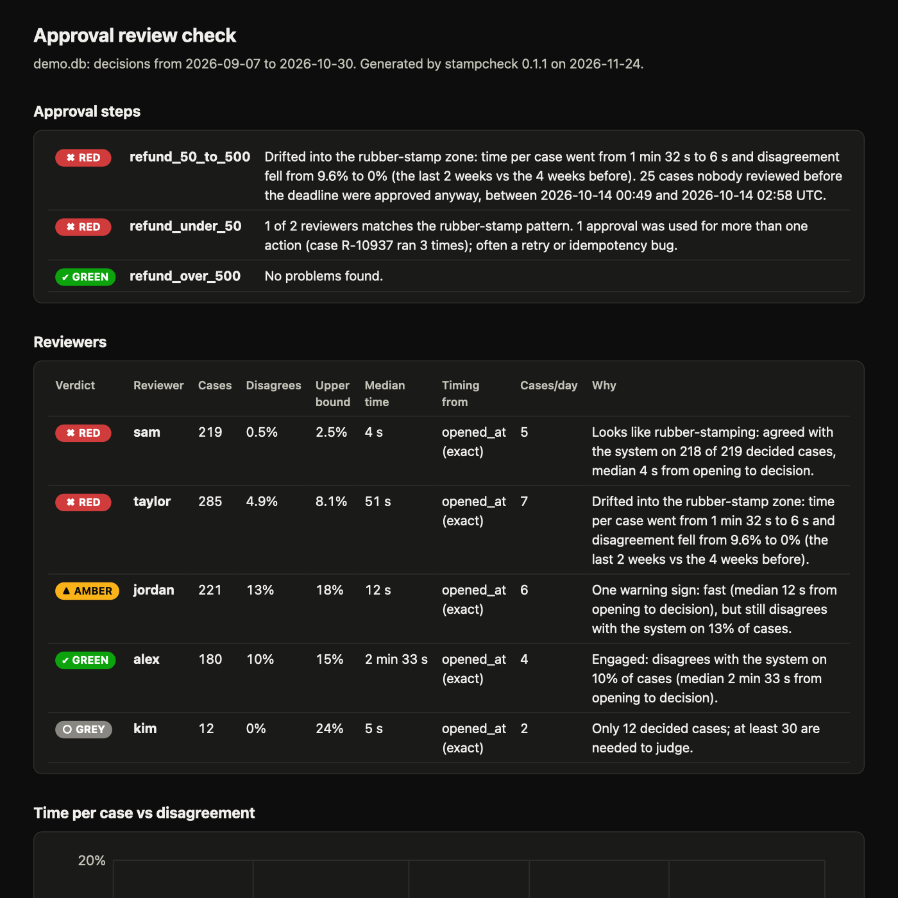

# StampCheck

**Find out whether the human approval step in your system still checks anything, or has quietly become a rubber stamp.**

Website: [noahberry01123.github.io/stampcheck](https://noahberry01123.github.io/stampcheck/)

```bash
pip install stampcheck
stampcheck demo
```



`stampcheck demo` builds 8 weeks of synthetic refund approvals, checks them, prints a summary, and writes `report.html`. It takes a few seconds and needs no setup.

Works with the approval logs you already have. Adding an opened_at timestamp makes the timings exact.

## Why this exists

- Many systems send automated decisions (refunds, account locks, takedowns) to a person for approval.
- Over a few months, reviewers learn that the software is usually right, so they start approving almost everything, in seconds.
- The log still says "approved by sam", whether sam read the case or not.
- Existing tools record **that** a review happened. Nothing checks **whether** it was real.
- This tool reads the review data you already have and tells you, in plain language, when a review step has stopped filtering anything.

It is read-only. It never blocks, gates, or changes a decision. Nothing leaves your machine except an optional Slack alert. If it breaks, nothing in production breaks.

## What the demo shows

The demo uses one scenario throughout: an AI support agent recommends whether to refund a customer, and human reviewers approve or reject. Refunds are split into three approval steps by size (under €50, €50 to €500, over €500). All names and data are synthetic. This is the real output:

```text
Approval steps
  RED    refund_50_to_500  Drifted into the rubber-stamp zone: time per case went from 1 min 32 s to
                           6 s and disagreement fell from 9.6% to 0% (the last 2 weeks vs the 4
                           weeks before). 25 cases nobody reviewed before the deadline were approved
                           anyway, between 2026-10-14 00:49 and 2026-10-14 02:58 UTC.
  RED    refund_under_50   1 of 2 reviewers matches the rubber-stamp pattern. 1 approval was used
                           for more than one action (case R-10937 ran 3 times); often a retry or
                           idempotency bug.
  GREEN  refund_over_500   No problems found.

Reviewers
  RED    sam     Looks like rubber-stamping: agreed with the system on 218 of 219 decided cases,
                 median 4 s from opening to decision.
  RED    taylor  Drifted into the rubber-stamp zone: time per case went from 1 min 32 s to 6 s and
                 disagreement fell from 9.6% to 0% (the last 2 weeks vs the 4 weeks before).
  AMBER  jordan  One warning sign: fast (median 12 s from opening to decision), but still disagrees
                 with the system on 13% of cases.
  GREEN  alex    Engaged: disagrees with the system on 10% of cases (median 2 min 33 s from opening
                 to decision).
  GREY   kim     Only 12 decided cases; at least 30 are needed to judge.

Timing from opened_at (exact, the most precise): alex, jordan, kim, sam, taylor
```

Taylor is the interesting one: over the whole 8 weeks taylor's numbers look fine. Only the drift check, which compares the last 2 weeks with the 4 weeks before, catches the slide.

## Make the timings exact: log when the case was opened

Works with the approval logs you already have. Adding an opened_at timestamp makes the timings exact.

Most systems log when a reviewer **decided**. Very few log when the reviewer **opened** the case. Without `opened_at`, StampCheck estimates time per case from the timestamps you do have (see [Timing](#timing-with-and-without-opened_at)). Those estimates can prove that someone is fast, but not that they read carefully. `record_review` is a one-line way to log the exact time:

```python
import stampcheck

stampcheck.record_review(
    case_id="R-1001",
    recommended="approve",          # what the system proposed: "approve" or "reject"
    decision="approve",             # what the human did: "approve", "reject" or "escalate"
    reviewer="sam",
    opened_at=opened_at,            # when the reviewer opened the case: makes timings exact
    decided_at=decided_at,          # when they decided
    notified_at=queued_at,          # optional: when the case entered the queue
    category="refund_under_50",     # optional: the approval step; each gets its own verdict
    executed=1,                     # optional: how many times the approved action ran
)
```

It writes to `./stampcheck.db` (SQLite). Pass `path="reviews.jsonl"` for JSON lines, or set `STAMPCHECK_PATH`. Timestamps can be datetimes, ISO strings, or epoch seconds. It never raises: if something goes wrong it logs a warning on the `stampcheck` logger and your approval flow carries on.

If nobody acted before a deadline and the system applied a default, log `decision="timeout_approve"` or `"timeout_reject"`.

When the human decides inside one function call (a CLI, a notebook, an agent loop), the context manager records both timestamps for you:

```python
with stampcheck.review(case_id, recommended="approve", reviewer=user_id, category="refund_under_50") as r:
    r.decision = ask_human(case)      # opened_at was recorded on enter
    r.executed = 1 if r.decision == "approve" else 0
# decided_at is recorded on exit
```

### FastAPI approval endpoint

In a web app, opening and deciding are two requests. Record `opened_at` when the case is served, and pass it at decision time. Full file: [examples/fastapi_endpoint.py](https://github.com/noahberry01123/stampcheck/blob/main/examples/fastapi_endpoint.py).

```python
@app.get("/refunds/{case_id}")
def open_case(case_id: str, reviewer: str):
    OPENED.setdefault((case_id, reviewer), datetime.now(timezone.utc))  # store this in your DB
    return CASES[case_id]

@app.post("/refunds/{case_id}/decision")
def decide(case_id: str, body: Decision):
    case = CASES[case_id]
    executed = 0
    if body.decision == "approve":
        issue_refund(case)
        executed = 1
    stampcheck.record_review(case_id, case["recommended"], body.decision, body.reviewer,
                            opened_at=OPENED.get((case_id, body.reviewer)),
                            decided_at=datetime.now(timezone.utc), notified_at=case["created_at"],
                            category=refund_band(case["amount_eur"]), executed=executed)
```

### Human approval step in an LLM-agent workflow

The agent proposes a tool call, a person approves it, and the tool runs only after approval. Full file: [examples/agent_approval.py](https://github.com/noahberry01123/stampcheck/blob/main/examples/agent_approval.py).

```python
proposal = agent_propose(ticket)                     # e.g. {"tool": "issue_refund", "recommendation": "approve", ...}
with stampcheck.review(ticket["id"], proposal["recommendation"], reviewer=current_user) as r:
    show_to_human(proposal)
    r.decision = wait_for_human()                    # "approve" / "reject" / "escalate"
    r.executed = 0
    if r.decision == "approve":
        run_tool(proposal)
        r.executed = 1
```

Then, once you have a few weeks of reviews:

```bash
stampcheck check --source stampcheck.db
```

## Reading your existing data

You don't need `record_review` to start. Point the check at what you already have.

```bash
stampcheck check --source reviews.csv                        # CSV or TSV, delimiter detected
stampcheck check --source reviews.jsonl                      # JSON lines
stampcheck check --source app.db --query "SELECT * FROM approvals"   # SQLite
pip install "stampcheck[postgres]"
stampcheck check --source "postgresql://readonly@db/app" --query "SELECT * FROM refund_reviews"
```

The check needs one row per reviewed case. The minimum is who decided, what they decided, when, and what the system recommended. Without the recommendation, only the speed checks run. Which checks can run depends on your data, and the output lists any that couldn't.

| Field | Needed | Meaning |
|---|---|---|
| `case_id` | yes | ID of the case or approval request |
| `decision` | yes | What happened: `approve`, `reject`, `escalate`, `timeout_approve`, `timeout_reject` |
| `decided_at` | yes | When the decision was made (for timeouts: when the deadline passed) |
| `reviewer` | for per-reviewer checks and gap-based timing | Who decided |
| `recommended` | for the agreement checks | What the system proposed: `approve` or `reject` |
| `opened_at` | no, but makes timings exact | When the reviewer opened the case |
| `notified_at` | no | When the case entered the queue. Used as an upper-bound timing when `opened_at` is missing |
| `category` | no | The approval step, e.g. refund size band. Each one gets its own verdict |
| `executed` | for the duplicate check | How many times the approved action ran. Several rows per case are summed |

Common column names are recognised automatically (`id`, `ticket_id`, `reviewed_by`, `first_viewed_at`, `closed_at`, `outcome`, and more). The check always prints the mapping it used. If your names differ, write a mapping file:

```bash
stampcheck init          # writes a commented stampcheck.yaml with every threshold and mapping option
```

```yaml
# stampcheck.yaml (or pass any file with --mapping)
columns:
  case_id: Ref
  recommended: AI Suggestion
  reviewer: Handled By
  opened_at: First Opened
  decided_at: Closed At
  category: Refund Band
values:
  recommended:
    REFUND: approve
    NO_REFUND: reject
  decision:
    AUTO_APPROVED_SLA: timeout_approve
    AUTO_REJECTED_SLA: timeout_reject
timezone: Europe/Berlin   # for timestamps without an offset
```

A worked example with semicolons, renamed columns, local time offsets, and a few garbage rows:

```bash
stampcheck check --source examples/messy.csv --mapping examples/mapping.yaml
```

Values are never guessed. Common spellings (`approved`, `Rejected`, `denied`, `ESCALATED`) are accepted and shown in the output. Anything else is listed with a count, and those rows are skipped until you map the value. Rows with no case ID or an unreadable `decided_at` are skipped and counted too.

The mapping file is YAML or JSON. PyYAML is optional (`pip install "stampcheck[yaml]"`); without it a built-in reader handles the simple format above.

## The checks

Each check gives a verdict (GREEN, AMBER, RED, or GREY for "not enough data") and one sentence explaining why. GREY never means pass.

| Check | RED / AMBER when | What it usually means |
|---|---|---|
| Rubber-stamping | RED: at least 30 decided cases, the 95% upper bound on the disagreement rate is under 5%, **and** the median time per case is under 30 s. AMBER: only one of the two | Reviewers click through. The step filters nothing |
| Drift | RED: the last 2 weeks are in the rubber-stamp zone and the 4 weeks before were not. AMBER: time per case fell by half or more, or disagreement fell clearly | A careful reviewer or team is sliding toward rubber-stamping |
| Silent timeout approvals | RED: any case nobody reviewed before the deadline that still ended in approval | A timeout default that fails open |
| Duplicate execution | RED: one approval used for more than one action | A retry or idempotency bug |
| Suspicious logging | AMBER: `recommended` or `decision` has one value on 99% or more of rows, or the second value appears fewer than 5 times | The column may be hard-coded. Findings built on it are not trusted |
| Queue overload | AMBER: more than 200 decided cases per reviewer per working day | Shown as the likely cause next to a rubber-stamp finding |

Disagreement means the human did something other than what the system recommended (escalating counts). The upper bound is the Wilson 95% interval: with few cases, a 0% rate is weak evidence, so the check asks how high the true rate could plausibly be.

### Timing with and without opened_at

The report says which timing source it used for each reviewer:

- **opened_at to decided_at**: exact, and the most precise. Used whenever `opened_at` is logged.
- **notified_at to decided_at**: includes time waiting in the queue, so it can only overstate the real time.
- **Gaps between a reviewer's consecutive decisions**: the reviewer can't have spent longer on a case than the time since their previous decision. Gaps over 30 minutes count as breaks and are ignored.

Without `opened_at`, StampCheck uses whichever of the two estimates is tighter. Both are upper bounds, so an estimate under 30 s is reliable evidence of speed. A longer estimate proves nothing either way: the reviewer might be reading, or the gaps might be waiting time. In that case a reviewer who agrees with almost everything gets AMBER, not GREEN, and the message says "Estimated from decision timestamps. Add opened_at logging for exact timings."

Every threshold lives in the config file (`stampcheck init` writes them all with comments), and every report prints the values it used.

## Output, exit codes, CI

`stampcheck check` prints a summary and writes two files to `--out` (default: the current folder):

- `report.html`: self-contained (no network). Verdict per approval step, a scatter of time per case against disagreement with the danger zone shaded, weekly trends, how verdicts are decided, and a data-quality section (rows read, rows skipped and why, missing columns, checks that could not run).
- `result.json`: the same results for scripts.

Exit codes: `0` nothing is RED, `1` something is RED, `2` input error. That makes it usable from cron or CI.

To get a Slack message only when something is RED or newly drifting:

```bash
stampcheck check --source "$DB_URL" --query "SELECT * FROM refund_reviews" --alert "slack:$SLACK_WEBHOOK_URL"
```

"Newly" is judged against the previous `result.json` in the output folder. A ready-to-copy weekly GitHub Actions workflow is in [examples/github-actions/stampcheck.yml](https://github.com/noahberry01123/stampcheck/blob/main/examples/github-actions/stampcheck.yml).

## Reviewers are people

Alerts are team-level and step-level by default: they say "1 of 2 reviewers matches the rubber-stamp pattern", not who. Add `--per-reviewer` to name reviewers in alerts, and `--pseudonymize` to replace reviewer IDs with salted hashes everywhere (set `pseudonymize_salt` in the config so hashes stay stable between runs). The terminal output and the local report show reviewer IDs, because you already have that data.

A rubber-stamp pattern usually points to a system problem: queues that are too long, a model that is right so often that checking feels pointless, or a timeout default that fails open. Patterns in review data are evidence to look into, not proof that anyone did anything wrong.

In some countries, monitoring individual employees needs agreement first. In Germany, for example, it usually needs the works council's (Betriebsrat) agreement. Start at team level.

## Development

```bash
pip install -e ".[dev,yaml]"
pytest
python tests/make_messy.py    # regenerate examples/messy.csv after changing the demo
```

Python 3.10 or newer. No runtime dependencies. MIT licence.

## Compliance

These checks relate to GDPR Art. 22, which covers decisions based solely on automated processing (official guidance says human involvement only counts if it is meaningful, not a token rubber stamp), and to EU AI Act Art. 14, which requires effective human oversight of high-risk AI systems from December 2027. The tool gives you evidence about your review step. It isn't legal advice.

Using this at work and need something for your DPO, auditor or a customer audit? Tell us what you need in [GitHub Discussions](https://github.com/noahberry01123/stampcheck/discussions).
